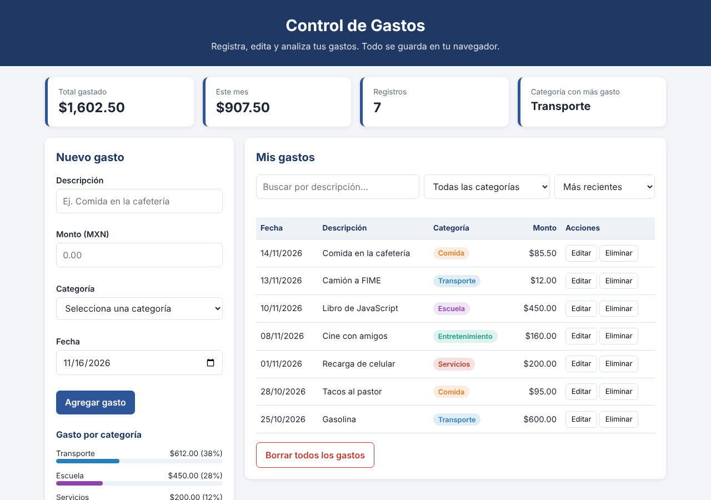
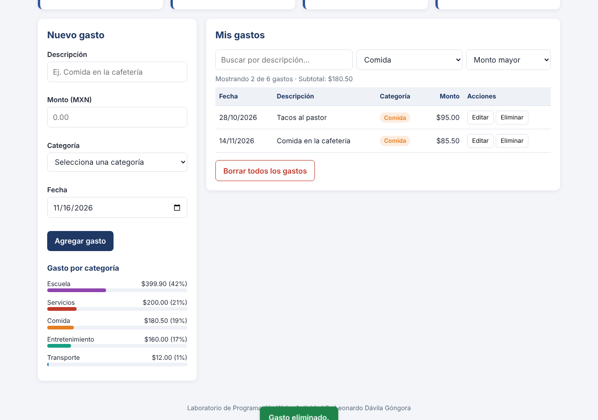
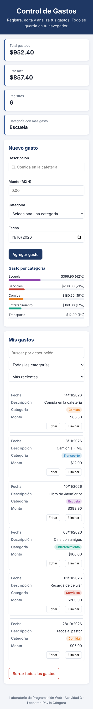

# Control de Gastos

Aplicación web del lado del cliente para registrar, editar y analizar gastos personales. Está hecha con HTML5, CSS3 y JavaScript ES6+, sin frameworks ni servidor: los datos se guardan en el `localStorage` del navegador y se conservan entre sesiones.

**Actividad 3. Aplicación interactiva con JavaScript moderno**
Laboratorio de Programación Web · UANL FIME · Grupo 406
Alumno: Leonardo Dávila Góngora (2145945)



## Cómo ejecutarla

No requiere instalación. Hay dos opciones:

1. Descargar o clonar el repositorio y abrir `index.html` con doble clic en Chrome, Edge o Firefox.
2. En VS Code, abrir la carpeta y usar la extensión **Live Server** (clic derecho en `index.html` → *Open with Live Server*).

## Funcionalidades

| Requisito | Cómo se cumple |
|---|---|
| Datos con objetos y arreglos | Cada gasto es un objeto `{ id, descripcion, monto, categoria, fecha, creado }` dentro del arreglo `gastos`. Las categorías también son un arreglo de objetos. |
| Agregar | Formulario "Nuevo gasto". |
| Visualizar | Tabla "Mis gastos" (en celular se muestra como tarjetas). |
| Editar | Botón **Editar** carga el gasto en el formulario; **Guardar cambios** lo actualiza. |
| Eliminar | Botón **Eliminar** (pide confirmación) y **Borrar todos los gastos**. |
| DOM sin recargar | `preventDefault()` en el envío del formulario y funciones `render()` que reconstruyen la tabla y el resumen. |
| Validación con mensajes claros | Descripción obligatoria (mín. 3 caracteres), monto entre $0.01 y $1,000,000, categoría obligatoria y fecha no futura. Los errores aparecen bajo cada campo, en rojo, y se quitan en cuanto el usuario corrige. |
| localStorage | `guardarEnStorage()` tras cada cambio y `cargarDeStorage()` al iniciar (con `try/catch` por si el JSON está dañado o el almacenamiento no está disponible; los registros con formato incorrecto se descartan). |
| Funciones adicionales | **Búsqueda** por descripción (ignora acentos y mayúsculas), **filtro** por categoría, **ordenamiento** por fecha o monto, **contador** de registros, **categorías** con color y **cálculo automático**: total general, total del mes, categoría con más gasto, subtotal de lo filtrado y porcentaje por categoría con barras. |



## Sintaxis moderna utilizada

- `const` / `let` (no se usa `var`).
- Arrow functions: `const sumar = (lista) => lista.reduce(...)`.
- Template literals para generar el HTML de las filas.
- Métodos de arreglos: `map`, `filter`, `reduce`, `find`, `some`, `sort`, `at`.
- Spread y desestructuración: `{ ...g, ...datos }`, `const { accion, id } = boton.dataset`.
- Operador `??`, separadores numéricos (`1_000_000`), `Intl.NumberFormat` para el formato de moneda.
- Delegación de eventos: un solo `addEventListener` en el `<tbody>` atiende todos los botones Editar y Eliminar.

## Estructura del proyecto

```
control-gastos/
├── index.html        Estructura de la página
├── css/styles.css    Estilos y diseño responsivo
├── js/app.js         Lógica de la aplicación
├── capturas/         Imágenes para este README
└── README.md
```

### Organización de `js/app.js`

1. Configuración (clave de storage, categorías)
2. Estado (`gastos`)
3. Referencias al DOM
4. Utilidades (formato de dinero y fechas, escape de HTML, avisos)
5. Persistencia (`guardarEnStorage`, `cargarDeStorage`)
6. Validación (`validar`, `mostrarErrores`)
7. CRUD (`agregarGasto`, `editarGasto`, `eliminarGasto`)
8. Búsqueda, filtro y orden (`obtenerVisibles`)
9. Cálculos (`sumar`, `totalesPorCategoria`)
10. Renderizado (`renderTabla`, `renderResumen`)
11. Formulario y eventos
12. Inicio (`iniciar`)

## Cómo revisar el localStorage

En DevTools (F12) → pestaña **Application** → **Local Storage** → clave `control-gastos:v1`. Ahí se ve el arreglo de gastos en formato JSON.

## Seguridad

El texto que escribe el usuario se pasa por `escaparHTML()` antes de insertarlo en la tabla, para que no se interprete como HTML.

## Vista en celular


